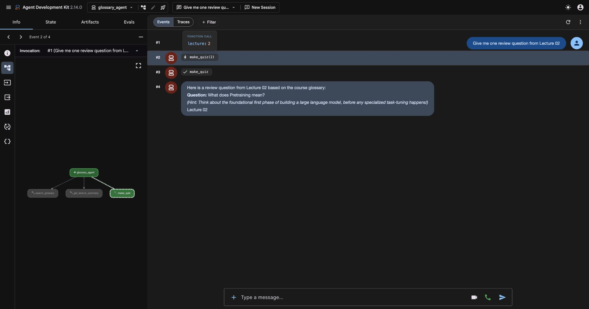

# Lecture 03 — Learning Support Agent

Completed the exercises and all three homework levels: **Basic, Implementation, and Advanced option (a), Google ADK**. The implementation adds glossary-based quizzes and approval-gated learning logs. Real model runs compare the bare model, Pydantic AI, and ADK; the unsuccessful run is included alongside the successful results.

## Setup and evidence

The work starts from the English course repository at `8d5b90c`. The controlled runs used `gemini-3.5-flash-lite`, temperature `0`, Pydantic AI `2.57.0`, and Google GenAI `2.31.0`. ADK `2.14.0` was installed separately for the Advanced comparison, without changing the core dependency lock. Runs were made on 9 November 2026.

The controlled Pydantic AI and ADK agents share the same three read-only functions: `search_glossary`, `get_lecture_summary`, and `make_quiz`. They do not offer the file-writing tool during comparisons. The normal CLI additionally offers `save_learning_log` with approval required. Each comparison starts a fresh conversation. Temperature zero reduces variation but does not guarantee identical output.

- [Experiment configuration, instructions, versions, and source hashes](results/experiment_config.json)
- [Recomputed request counts, calls, tokens, and ADK answers](results/verified_summary.json)
- [Verification output](results/verification.txt), [test output](results/pytest.txt), and [ADK environment](results/adk_environment.json)

There are 12 controlled bare/Pydantic records: 11 produced answers and one stopped at its request limit. Three ADK CLI runs produced answers. Their recorded total is **32 LLM requests**. This is not a total API billing count: it excludes earlier attempts, a failed serialization run, the separate CLI demonstration, and the ADK web demonstration. Earlier failed attempt records remain in `results/attempts/`; they are not silently counted as successes.

## Exercises

### 1. Bare model versus a tool-using agent

For “What is a lecNN-start tag in the AIE2026 course?”, the bare model used one request and gave a plausible explanation of starter-code tags. It also guessed that matching `lecNN-finish` or `lecNN-solution` tags usually exist, which the supplied glossary does not establish. The agent instead called `search_glossary({"query":"lecNN-start"})` and used the returned course definition. It needed two model requests: one to request the tool and another to compose the answer after receiving its result.

The second course-specific question was “What are the 3 homework levels in the AIE2026 course?” The bare model invented labels such as “Intermediate / Core Application.” The actual course labels are Basic, Implementation, and Advanced. Giving the agent access to the right data did **not** guarantee it would retrieve that data: the Pydantic run called `get_lecture_summary` for lectures 1 through 6 and stopped at the six-request cap without a final answer. The trace is a failure result, not a correct answer. In the ADK comparison, the model searched for `homework levels` and answered correctly in two requests.

Evidence: [bare tag answer](results/bare_tag.json), [agent tag answer](results/exercise_tag.json), [bare levels answer](results/bare_levels.json), and [failed agent levels trace](results/exercise_levels.json).

### 2. Read the tool calls

For “What is the difference between LoRA and QLoRA?”, the recorded calls were:

```text
search_glossary({"query":"LoRA"})
search_glossary({"query":"QLoRA"})
requests = 2
```

Both tool requests appeared in the first model response. The second response explained that LoRA learns small low-rank updates while freezing the base weights, and QLoRA additionally quantizes the base weights to reduce memory use. Two tool calls therefore did not mean three model requests. The result ended with Lecture 02, consistent with the retrieved entries. See the [full messages and answer](results/exercise_comparison.json).

### 3. Add and register a quiz tool

`make_quiz(lecture: int)` in [app/tools.py](../../app/tools.py) chooses the first glossary entry for the requested lecture and returns its term, lecture, question, and exact glossary definition. The deterministic choice makes source fidelity easy to verify. An unavailable lecture returns an explicit unavailable message instead of inventing content.

Its docstring tells the model to use it when a learner requests practice or a review question, and explains that the answer comes directly from the glossary. It is registered with `agent.tool_plain` in [app/agent.py](../../app/agent.py).

For “Give me one review question from Lecture 02”, the model called `make_quiz({"lecture":2})` and produced a question about **Pretraining**, with a hint rather than immediately revealing the answer. The tool still returned the answer for subsequent feedback. The controlled run used two model requests. A separate run of the actual `--trace` CLI also showed this call and two requests.

Evidence: [controlled quiz trace](results/exercise_quiz.json), [actual CLI trace](results/cli_quiz_trace.txt), and [four registered tools and their descriptions](results/tool_list.txt).

## Basic — change one instruction and compare

Only the first bullet of `INSTRUCTIONS` was changed for this experiment.

Before:

> Always check the glossary with search_glossary before answering about terms or course-specific information.

After:

> Check search_glossary before defining named terms or course-specific terminology. For an overview of a numbered lecture, call get_lecture_summary directly; search the glossary only if a particular term needs clarification.

The hypothesis was that explicitly distinguishing a lecture overview from a term definition would avoid an unnecessary glossary lookup. The same question, “What will we learn in Lecture 03?”, was run three times with each instruction version. Model, temperature, tools, and source data were held constant.

| Pair | Before: calls / requests | After: calls / requests | Input tokens before → after | Output tokens before → after |
|---|---|---|---|---|
| 1 | `get_lecture_summary(3)` / 2 | `get_lecture_summary(3)` / 2 | 1,184 → 1,230 | 264 → 256 |
| 2 | `get_lecture_summary(3)` / 2 | `get_lecture_summary(3)` / 2 | 1,184 → 1,230 | 239 → 234 |
| 3 | `get_lecture_summary(3)` / 2 | `get_lecture_summary(3)` / 2 | 1,184 → 1,230 | 215 → 280 |

**The expected routing improvement did not occur.** The original instructions already selected the lecture-summary tool in all three trials. The revised version used 46 additional input tokens per conversation, with no reduction in requests. Both versions covered the model/loop/tools structure, tool descriptions, loop costs, frameworks, and approval. Wording and detail varied: for example, the first baseline answer included a separate hands-on-exercises bullet, while the first revised answer condensed the material into five topic bullets. These variations are not evidence of a systematic quality improvement.

The six full records are `results/basic_1_before.json` through `results/basic_3_after.json`; [pair 1 before](results/basic_1_before.json) and [pair 1 after](results/basic_1_after.json) illustrate the comparison. The separate homework-level retrieval failure suggests a useful next evaluation case, but this experiment does not establish that the instruction change caused that failure.

## Implementation — approved learning logs

`save_learning_log(lecture, topic, reflection)` saves a new JSON file under `learning_log/`. It requires a positive lecture number, nonblank text, a topic of at most 200 characters, and a reflection of at most 4,000 characters. Validation happens before creating the directory. A generated filename and exclusive file creation preserve previous records. The record includes a UTC timestamp; the caller does not choose a filesystem path.

The tool is registered with `requires_approval=True`. The agent can return `DeferredToolRequests`; `run_with_approval` displays the proposed tool name and exact arguments, asks `[y/N]`, and resumes with `DeferredToolResults`, the original tool-call identifier, and the conversation history. Only `y` or `yes` approves. Blank input, other responses, and EOF deny the request. A shared budget limits the entire CLI conversation, including approval resumptions, to eight model requests and twelve tool calls.

The approval boundary belongs to the harness. A model sentence saying it saved something is not evidence of a file write. The tests inspect actual files in temporary directories:

| Decision | Files before decision | Files after decision | Observed outcome |
|---|---:|---:|---|
| Deny | 0 | 0 | Tool result records denial; nothing is saved |
| Approve | 0 | 1 | Saved lecture, topic, and reflection match the approved arguments |

These are explicitly **offline TestModel simulations**, not live Gemini approval conversations. They exercise the deferred-call and resume mechanism deterministically. Additional tests cover CLI yes/no/blank/invalid/EOF decisions, successive saves preserving earlier contents, invalid inputs, quiz source fidelity, unavailable quizzes, and tool registration. TestModel-generated sample strings are test data, not personal learning reflections.

Evidence: [tests](../../tests/test_lecture03.py), [approval verification code](verify_approval.py), and [saved outcomes and messages](results/approval_verification.json). The complete test suite passed: **28 passed in 2.28s**. Logs, credentials, local environments, and ADK session files are excluded from version control.

## Advanced (a) — the same read-only agent in ADK

[The ADK adapter](../../adk_agent/glossary_agent/agent.py) imports the same `INSTRUCTIONS` and the same three Python functions rather than maintaining copies. Pydantic AI creates `Agent(instructions=...)` and registers functions through `tool_plain`; ADK exposes `root_agent = Agent(instruction=..., tools=[...])`. Both frameworks turn type hints and docstrings into tool definitions and run the model/tool loop. ADK provides session/event handling and its own CLI and web UI; the Pydantic implementation uses the course CLI and message objects. The write-approval extension remains in Pydantic AI and is not claimed as an ADK feature of this adapter.

Fresh `adk run --jsonl --in_memory` sessions used the same model, temperature, questions, and read-only tools as the controlled Pydantic comparisons.

| Question | Pydantic AI | ADK | Answer comparison |
|---|---|---|---|
| LoRA versus QLoRA | Two glossary calls; 2 requests | Same two glossary calls; 2 requests | Both explain low-rank updates and additional quantization; wording differs |
| Three homework levels | Six lecture-summary calls; limit reached | `search_glossary("homework levels")`; 2 requests | Pydantic produced no final answer; ADK returned Basic, Implementation, Advanced |
| Lecture 02 review question | `make_quiz(2)`; 2 requests | `make_quiz(2)`; 2 requests | Both use Pretraining and give a hint |

For the LoRA comparison, recorded input/output tokens were 1,337/276 in Pydantic AI and 1,461/226 in ADK. Identical Python tools and instruction text do not make the frameworks' complete provider requests identical: schemas, wrapping, and orchestration can differ. These few trials do not establish general superiority or isolate the cause of the different homework-level tool choices.

Evidence: [ADK LoRA events](results/adk_comparison.jsonl), [ADK homework-level events](results/adk_levels.jsonl), and [ADK quiz events](results/adk_quiz.jsonl).

The agent was also run in **adk web**. A separate Lecture 02 quiz request showed the user message, the `make_quiz` call with `lecture: 2`, its result, and the model's final question/hint in the UI's event history. The web view makes the intermediate tool event visible alongside the conversation, while the course CLI prints the trace after the answer.



## Reproduce and inspect

Run these commands from a Git checkout of this branch. Configure `GEMINI_API_KEY` privately in the environment for live runs; do not commit it. No API key is needed for the tests, tool listing, or evidence verification.

```bash
uv sync
uv run pytest -q
uv run python -m app.agent --list-tools
uv run python -m lectures.03.verify_results
uv run python -m lectures.03.verify_approval
uv run python -m app.agent --trace "Give me one review question from Lecture 02"
uv run python -m app.agent --trace "Save a learning log for Lecture 03: topic tool approval; reflection I should check actual file effects."
```

The second CLI command asks before saving. Type `n` to deny or `y` to approve the displayed arguments. For the live comparisons:

```bash
uv run python -m lectures.03.run_experiments
uv run python -m lectures.03.run_adk_experiments
PYTHONPATH="$PWD" uv run --with google-adk==2.14.0 adk web adk_agent
```

The experiment scripts keep successful records on resume; the Pydantic script archives a failed record before retrying it. To obtain a completely fresh comparison, first move the existing result files to another directory. The baseline instruction is read from Git commit `8d5b90c`, so this reproduction step requires the repository history. Running live experiments can consume API quota and produce different answers. [verify_results.py](verify_results.py) instead recomputes the published claims offline from the saved evidence, including request counts, token sums, tool arguments, glossary source hashes, and approval file outcomes.

The main lesson is that tool access, instruction wording, stopping limits, and approval are separate responsibilities. A useful agent needs the right data, successful retrieval, bounded execution, and verification of external effects; a fluent final sentence alone cannot demonstrate those properties.
